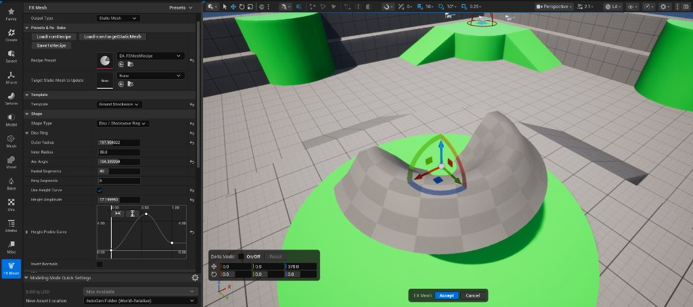

# FXMeshGenerator

A procedural VFX mesh generation plugin for **Unreal Engine 5** that lets you author, inspect, and bake custom VFX meshes directly inside the editor's built-in **Modeling Mode** (`Shift + 5`) — without needing an external 3D DCC tool.

---

## Features

### Built-In Modeling Mode Tool (`FX Mesh`)
Registers a dedicated **FX Mesh** category tab and interactive tool inside Unreal Engine's **Modeling Mode** (`IModelingModeToolExtension`) with live viewport preview, an interactive translate/rotate gizmo, live vertex/triangle stats, and standard Modeling Mode output options (`Static Mesh`, `Dynamic Mesh`, `Volume`).

### 8 Procedural VFX Base Shapes
Each shape exposes its own dedicated parameter set and optional profile curve:
- **Cylinder / Tube** — beams, tunnels, hollow vortexes (`BottomRadius`, `TopRadius`, `Height`, `ArcAngle`, `bCapBottom`, `bCapTop`, `RadiusProfileCurve`)
- **Cone / Funnel** — directional bursts, muzzle flashes, spell cones (`BaseRadius`, `TipRadius`, `Height`, `ArcAngle`, `bCapBase`, `bCapTip`, `RadiusProfileCurve`)
- **Slash / Swept Arc** — tapered crescent slash shells (`OuterRadius`, `InnerRadius`, `ArcAngle`, `ArchHeight`, `bTaperTips`, `WidthProfileCurve`)
- **Disc / Shockwave Ring** — ground impacts, portals, radial flashes (`OuterRadius`, `InnerRadius`, `ArcAngle`, `HeightProfileCurve`)
- **Sphere / Hemisphere Dome** — shields, shockwave domes, explosions with split-pole UV mapping (`Radius`, `VerticalSweepAngle`, `HorizontalArcAngle`, `bCapBase`, `RadiusProfileCurve`)
- **Ribbon / Trail Strip** — sword trails, lightning arcs, motion ribbons (`Length`, `Width`, `WidthProfileCurve`)
- **Cross-Plane / Star Card** — intersecting multi-plane cards for stylized flames and smoke (`PlaneCount`, `Width`, `Height`, `WidthProfileCurve`)
- **Torus / Portal Ring** — portal rims and energy halos (`MajorRadius`, `TubeRadius`, `ArcAngle`, open-arc `bCapStart` / `bCapEnd`, `TubeRadiusCurve`)

### 7 One-Click VFX Templates
Quick-start presets that configure shape, modifiers, and vertex-color masks automatically:
- **Sword Slash** · **Ground Shockwave** · **Energy Beam** · **Tornado / Vortex** · **Shield Dome** · **Flame Cross-Card** · **Portal Ring**

### Ordered Deformation Modifier Stack
Add, reorder, toggle, and stack curve-driven modifiers evaluated top-to-bottom:
- **Taper** · **Twist** · **Bend** · **Wave** · **Noise (3D Perlin)** · **Inflate / Bulge**

### Shader & Niagara-Ready UVs & Vertex Colors
- **UV0 Controls:** `ShapeDefault` or `PolarRadial` projection, tiling, offset, rotation, flip U/V, and swap U/V.
- **Extra UV1 Packing:** Packs normalized `(RadialDistance, VProgress)` into UV1 for shader-driven animation.
- **Per-Channel Vertex Color Baking (`R`, `G`, `B`, `A`):** Map each channel independently to `Constant`, `AxisGradientU`, `AxisGradientV`, `EdgeFalloffU`, `EdgeFalloffV`, or `RadialDistance`.
- **Pivot & Orientation:** `Base` / `Center` / `Top` pivot presets and `+X` / `+Y` / `+Z` up-axis alignment.

### Live Viewport Diagnostics
Inspect geometry without altering the final baked material:
- **Shaded / Target Material** · **UV Checker** · **Vertex Colors (RGBA / R / G / B / A)** · **Normals** · **Backface Highlight (Red)** · **Wireframe Overlay**

### Non-Destructive Recipe Presets & Reference-Preserving Re-Bake
- **FX Mesh Recipe (`UFXMeshRecipeAsset`):** Save and load complete shape + modifier + UV/vertex-color setups as reusable DataAssets (supports **Create New Asset → FX Mesh Recipe** in the Content Browser and asset slot, or auto-creates via Save dialog when clicking **SaveToRecipe**).
- **In-Place Static Mesh Update:** Assign an existing `UStaticMesh` to **Target Static Mesh To Update** to overwrite it in-place on **Accept** without breaking Niagara, Material, or Blueprint references. Baked Static Meshes automatically store their recipe in `UFXMeshRecipeUserData` so you can reload and iterate later via **LoadFromTargetStaticMesh**.

---

## Getting Started

1. Enable the **FXMeshGenerator** plugin (requires **ModelingToolsEditorMode** and **GeometryScripting**, enabled automatically by the plugin).
2. Switch to **Modeling Mode** (`Shift + 5`).
3. Open the **FX Mesh** tab in the Modeling Mode toolbar and select **FX Mesh**.
4. Pick a **Template** or **Shape Type**, stack **Modifiers**, inspect UVs/Vertex Colors with **Diagnostics**, and click **Accept** to bake your mesh.

---

<strong>Deprecated: Legacy Geometry Script Blueprint Version</strong>

> **Deprecated:** The original Blueprint / Geometry Script workflow (`BP_FXMesh`, `BP_FXSweep`) has been superseded by the built-in Modeling Mode **FX Mesh** tool above.

A simple tool that lets you make a custom mesh for VFX purposes. So you don't need to use any external 3d tool to make your mesh.
It is made by Geometry Script in Unreal Engine 5!

